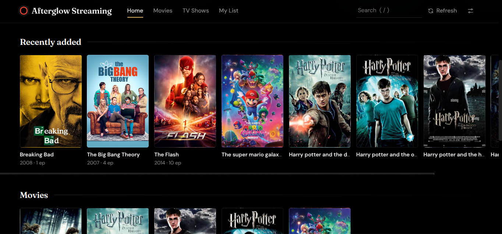
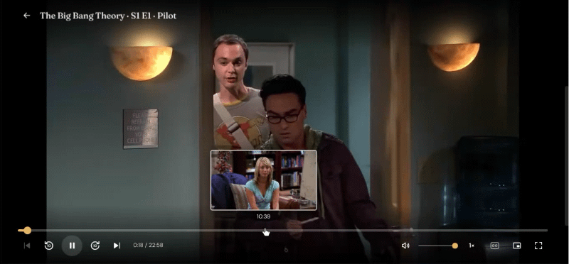
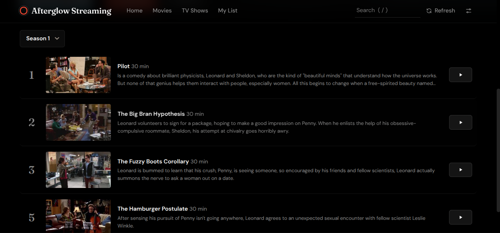
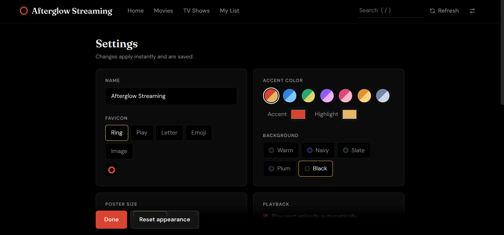

# Afterglow Streaming

A personal streaming-style media player that runs entirely in your browser. Point it at a folder of movies and TV shows on your computer and you get a Netflix-like library with posters, descriptions, resume-where-you-left-off, subtitles and a seek bar with preview thumbnails.

It is a single file (`afterglow-streaming.html`). There is no server, no account and no install.

**[Download Afterglow Streaming](https://copilott112.github.io/Afterglow/)** · [All releases](https://github.com/copilott112/Afterglow/releases)





<p>
  
  
</p>

## Contents

- [Quick start](#quick-start)
- [Folder layout](#folder-layout)
- [Supported formats](#supported-formats)
- [Features](#features)
- [Keyboard shortcuts](#keyboard-shortcuts)
- [Privacy and data](#privacy-and-data)
- [Troubleshooting](#troubleshooting)
- [Known limitations](#known-limitations)
- [Credits](#credits)
- [License](#license)

## Quick start

1. Download `afterglow-streaming.html` from the [download page](https://copilott112.github.io/Afterglow/) and save it anywhere on your computer.
2. Open it in **Chrome, Edge or another Chromium-based browser**. Double-click the file, or drag it into a browser window. These browsers can remember your folder between visits.
3. Click **Choose Content folder** and select your `Content` folder (see [Folder layout](#folder-layout)).
4. Wait a moment while posters and descriptions load, then press play.

The app remembers your folder, so next time you only need to open the file. If the browser asks for permission again, click **Reconnect folder**. Your history and list are kept.

## Folder layout

Pick the folder that contains a `Shows` folder, a `Movies` folder, or both (folder names are not case-sensitive). Videos can sit in subfolders. Anything outside `Shows` and `Movies` is ignored.

```
Content/
├── Shows/
│   └── Breaking_Bad/
│       ├── Breaking_Bad__s01_e01.mp4
│       ├── Breaking_Bad__s01_e01.srt        (optional subtitles)
│       └── Breaking_Bad__s01_e02.mp4
└── Movies/
    ├── The_Dark_Knight_(2008).mp4
    └── Spirited_Away_2001.mp4
```

**Shows** must be named `Show_Name__sXX_eYY.ext`: two underscores, then `s` and the season number (1–2 digits), `_e` and the episode number (1–3 digits). `S`/`E` in capitals also work. Single underscores in the name become spaces. Use exactly the same show name in every file, because the name is how episodes are grouped. Files in `Shows` that don't match this pattern are skipped.

**Movies** are named `Movie_Title_(Year).ext` or `Movie_Title_Year.ext`. The year (1900–2099) is optional but helps find the right poster and description. Underscores become spaces.

## Supported formats

| Works almost everywhere | Depends on your browser and codecs |
| --- | --- |
| MP4 (H.264 video, AAC audio), WebM | MKV, AVI, MOV, WMV, TS, M4V, OGV (all of these are scanned) |

Your browser decides what it can actually play. If a file won't play, convert it to MP4 (H.264/AAC).

## Features

**Library**
- Home page with a featured title, Continue watching, Recently added, My list, genre rows, Movies and TV shows
- Posters, descriptions, genres and runtime fetched automatically, plus ratings, episode titles and episode images for TV shows
- Mark movies as watched or unwatched from their page
- Search by title, episode name, or `show s1e3`
- "Surprise me" picks something at random
- Progress is saved automatically, and you can remove an item from Continue watching with the ✕ on its poster

**Player**
- Seek bar with preview thumbnails, generated in the background for instant scrubbing
- Subtitles: a `.srt` or `.vtt` file with the same name as the video (or with a language tag, like `Movie.en.srt`) loads automatically. You can also drop a file onto the player or right-click the CC button. UTF-8 and Windows-1252 encodings are handled
- Playback speed from 0.5× to 2×
- Picture-in-picture, fullscreen, remembered volume, and a remaining-time toggle (click the time)
- A Next episode button appears in the last 30 seconds of an episode (not on a show's final episode). When an episode ends, the next one starts after an 8-second countdown unless you turn that off in Settings
- Media key support and the current title shown in the browser tab
- Double-click the left or right side of the video to skip 10 seconds

**Personalization** (Settings)
- Name, accent and highlight colors, five background themes, favicon (ring, play, letter, emoji or your own image)
- Poster size, heading font, film grain
- Default speed, subtitle size, thumbnail previews on or off
- Export and import a backup of your watch history, My list and settings. The backup does not include your video files, the metadata cache or folder permission

## Keyboard shortcuts

| Key | Action |
| --- | --- |
| `Space` / `K` | Play or pause |
| `←` `→` / `J` `L` | Seek 10 seconds (hold `Shift` for 5) |
| `↑` `↓` | Volume |
| `0`–`9` | Jump to 0–90% of the video |
| `<` `>` | Playback speed |
| `C` | Subtitles on or off |
| `I` | Picture-in-picture |
| `F` | Fullscreen |
| `N` / `P` | Next or previous episode |
| `S` | Next episode (when the button is showing) |
| `M` | Mute |
| `Home` / `End` | Start or end |
| `?` | Show shortcuts |
| `Esc` | Close the shortcuts panel, or the player. In fullscreen it exits fullscreen first |
| `/` | Focus search (outside the player) |

## Privacy and data

- Your videos never leave your computer. They are read directly from disk by the browser.
- The only network requests are for metadata, artwork and fonts. Titles and years are sent to [TVMaze](https://www.tvmaze.com) (shows), and to the iTunes Search API with Wikipedia as a fallback (movies). Posters come from those services; when no artwork is found, or while metadata is still loading, the app falls back to a Bing image search using the title. Fonts load from Google Fonts. No keys or accounts are needed.
- Watch progress, My list, settings and the metadata cache are stored in your browser (localStorage and IndexedDB). They stay on this browser and device, so use **Export backup** in Settings to move them elsewhere.

## Troubleshooting

| Problem | Fix |
| --- | --- |
| "Your browser can't play this file" | The codec isn't supported. Convert to MP4 (H.264/AAC), or try Edge or Chrome |
| "No Shows or Movies folder found" | Select the folder that contains them, not one of them directly |
| A show doesn't appear | Check the file name follows `Name__s01_e01.mp4` and sits under a `Shows` folder |
| Wrong poster or description | Make the file name closer to the real title (add the year for movies), then **Settings → Clear metadata cache** |
| Posters or descriptions missing | Check your connection and any ad blocker, then press **Refresh** |
| "Metadata rate limit hit" | The free lookup services limit requests. Wait a minute and press **Refresh** |
| Folder permission keeps expiring | Click **Reconnect folder**. Browsers may ask again after a restart |
| Playback stutters while scrubbing on very large files | Turn off **Seek bar preview thumbnails** in Settings |
| Browser without the folder picker (typically Firefox and Safari) | You can still choose the folder each visit. Your history and list are saved |

## Known limitations

- Only one subtitle track is loaded automatically per video, and there is no language picker.
- Metadata depends on free public services and can occasionally match the wrong title.
- There is no intro detection or skipping.
- Chromium-based browsers (Chrome, Edge) give the best experience because they can remember your folder.

## Credits

- Show information and images come from [TVMaze](https://www.tvmaze.com). Movie information comes from the iTunes Search API and Wikipedia.
- Fonts: [Fraunces](https://fonts.google.com/specimen/Fraunces) and [DM Sans](https://fonts.google.com/specimen/DM+Sans) via Google Fonts.
- Afterglow Streaming does not host, stream or provide any media. It only plays video files that you already have on your own computer.
- Movie and show names, posters and artwork belong to their respective owners.

## License

Afterglow Streaming is released under the [MIT License](LICENSE). The license covers this project's code only; posters, metadata and fonts belong to their respective owners and services.
